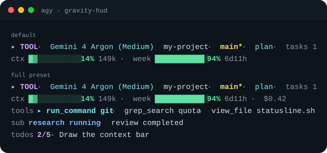

# gravity-hud

**Unofficial.** gravity-hud is an independent open-source project. It is not affiliated with, endorsed by, or sponsored by Google. Antigravity is a trademark of Google LLC.

A real-time status line for the [Antigravity CLI](https://antigravity.google/docs/cli/statusline/) (`agy`). Two lines by default: what the agent is doing, which model, which repo, and how close you are to the context window and the quota reset. Turn on one more preset when you also want the tool it is running and the checklist it is working through.



The picture is the real renderer, not a mock. It is `assets/hero.svg`, built from [`fixtures/session.json`](fixtures/session.json) and [`fixtures/transcript.jsonl`](fixtures/transcript.jsonl). The default install is the first two lines. `full` adds tools, subagents, todos, and cost. Sample git state in the preview is `main*`.

Plain text of that same render, colors removed:

```text
▸ TOOL · Gemini 4 Argon (Medium) · my-project · main* · plan · tasks 1
ctx █▓░░░░░░░░░░ 14% 149k · week ███████████░ 94% 6d11h · $0.42
tools ▸ run_command git · grep_search quota · view_file statusline.sh
sub research running · review completed
todos 2/5 · Draw the context bar
```

Inspired by [claude-hud](https://github.com/jarrodwatts/claude-hud) by Jarrod Watts (MIT, Copyright (c) 2026 Jarrod Watts). gravity-hud is a separate program for `agy`, not a fork or a reskin of that project.

## What you get

- Agent state, model and effort, project directory, and a live git branch with a `*` when the worktree is dirty.
- A context bar (used) and a quota bar (remaining) with a reset countdown from `reset_in_seconds` or `reset_time`.
- Narrow terminals drop lower-priority segments instead of wrapping into a mess. `TERM=dumb` and `--ascii` switch the bars to `#` and `-`.
- Optional lines, off in the default preset: the current and recent tools, subagents, and todo progress parsed from the conversation transcript.
- Transcript parsing is incremental. A small cache remembers the byte offset, so a refresh does not reread the whole log.
- Zero runtime dependencies. Node.js 18+ is the only requirement.
- Missing or unknown JSON fields degrade to a dash or a short label. The process still prints a line and exits 0, so `agy` does not disable it after repeated failures.

## Install

```bash
npx gravity-hud install
```

That copies a small launcher to `~/.gemini/antigravity-cli/gravity-hud/`, backs up `~/.gemini/antigravity-cli/settings.json` when the file already exists, and sets:

```json
{
  "statusLine": {
    "type": "command",
    "command": "~/.gemini/antigravity-cli/gravity-hud/statusline.sh"
  }
}
```

On Windows the command is `statusline.cmd`. A leading `~` is expanded by `agy`. Restart `agy`, or run `/statusline enable` if you had turned the command off.

From a git checkout, before the package is on npm:

```bash
node bin/gravity-hud.js install
```

Useful flags:

```bash
gravity-hud install --dry-run
gravity-hud install --preset full
gravity-hud install --force          # replace a different status line command
gravity-hud uninstall                # restore the previous statusLine value
```

`install` will not replace an existing `statusLine.command` that is not gravity-hud unless you pass `--force`. Invalid JSON is left untouched. The new file is written in one rename and, on Unix, mode `0600`. Up to five timestamped backups are kept next to `settings.json`.

### Antigravity plugin

```bash
agy plugin install https://github.com/sb1733831438-maker/gravity-hud
```

This installs a valid plugin (`plugin.json`, logo, and a `/gravity-hud` skill). The [plugin manifest](https://antigravity.google/docs/build-plugins/) has no status-line field, so the plugin install does not edit `settings.json`. After it lands, run:

```bash
node ~/.gemini/config/plugins/gravity-hud/bin/gravity-hud.js install
```

You can also point `/statusline` at the launcher yourself:

```text
/statusline ~/.gemini/antigravity-cli/gravity-hud/statusline.sh
```

## Try it without agy

```bash
node bin/gravity-hud.js preview
node bin/gravity-hud.js preview --preset full --width 96
node bin/gravity-hud.js < fixtures/session.json
node bin/gravity-hud.js doctor
```

`preview` prints the bundled sample and says so on stderr. It does not read your repository.

## Configure

The installer writes a config file the first time, and will not overwrite one that already exists.

| Platform | Path |
| --- | --- |
| macOS and Linux | `~/.config/gravity-hud/config.json` |
| Windows | `%APPDATA%\gravity-hud\config.json` |

`GRAVITY_HUD_CONFIG_DIR` and `GRAVITY_HUD_HOME` override those locations. `NO_COLOR` or `GRAVITY_HUD_ASCII=1` overrides the file for a single run.

```json
{
  "preset": "compact",
  "theme": "gravity",
  "ascii": "auto",
  "color": "auto",
  "segments": {
    "model": true,
    "project": true,
    "git": true,
    "agent": true,
    "context": true,
    "quota": true,
    "mode": true,
    "sandbox": true,
    "tasks": true,
    "tools": false,
    "subagents": false,
    "todos": false,
    "cost": false
  }
}
```

Presets:

| Preset | Lines |
| --- | --- |
| `minimal` | State, model, git, context, quota |
| `compact` | The default. Adds project, mode, sandbox, and background task count |
| `full` | Compact, plus tools, subagents, transcript todos, and estimated cost |

Themes are `gravity` (default), `dawn`, `ember`, and `mono`. They use the 16-color ANSI palette so they survive the `agy` TUI. `colors` can replace individual ANSI codes, for example `{ "model": "95", "good": "96" }`. `bars.width` sets the meter length (4–20). `gitTimeoutMs` clamps the local `git status` (50–2000, default 180).

Segment flags in the file win over the preset. Set `"tools": true` on `compact` if you only want the tool line.

## How todos and tools are read

`agy` does not put the checklist on stdin. The status line reads `transcript_path` from the session JSON. Each line is a step. Tool calls live on `PLANNER_RESPONSE.tool_calls` (`name`, `args`). The following step (`VIEW_FILE`, `RUN_COMMAND`, `CODE_ACTION`, …) is the result.

Todos come from task artifacts:

- `write_to_file` of `task.md` (or `ArtifactMetadata.ArtifactType` of `task`) replaces the checklist from `CodeContent`.
- `replace_file_content` and `multi_replace_file_content` update matching lines from `ReplacementContent` and `ReplacementChunks`.
- `task_boundary` supplies the current task name and status when there is no checklist yet.

Marks follow the task file convention: `[ ]` pending, `[/]` in progress, `[x]` done. Checkboxes in ordinary source files are ignored. A tool chip shows a file basename or the program name, not the full command line.

The cache is a small JSON file under the config directory. It stores the file offset plus those short labels. Files larger than 1.5 MB are tailed (512 KB) on the first read so a refresh stays cheap; later appends are read from the saved offset.

## Comparison

Public projects as of November 2026. This is a feature sketch, not a scoreboard.

| | gravity-hud | [agy-powerline](https://github.com/wassim-azi/agy-powerline) | [antigravity-cli-statusline](https://github.com/AndyAWD/antigravity-cli-statusline) | [agy-hud](https://github.com/franksde/agy-hud) |
| --- | --- | --- | --- | --- |
| Transcript tools and todos | Yes, incremental | Session payload widgets | Large indicator set | Context, quota, model, agent |
| Context and quota | Bars and reset countdown | Bars, pace, and run-out forecasts | Several quota pools and locales | Compact bars |
| Git | Branch and dirty, from local git | Branch, ahead/behind, stash, links | Branch and dirty | Limited |
| Themes | 4 presets, 16-color | Many themes and a live editor | Locales and label styles | Icon set |
| Runtime dependencies | None | None | Node.js | Node.js (bundled script) |
| Install | `npx gravity-hud install` edits `settings.json` | `npx agy-powerline` | `agy plugin install` | Plugin archive |
| Network | Never | None claimed by the project | Not required for the status line | Can refresh quota via `agy` |

gravity-hud does not forecast when a quota will run out. That is the part of agy-powerline worth using if you want pacing. This project is the one that reads the transcript.

## Privacy

- The account `email` on stdin is deleted before rendering and scrubbed if it still appears in the output. There is no option to show it.
- The process does not open sockets and does not call `fetch`.
- It does not read `~/.ssh`, cloud credential files, or the keychain. Transcript paths that point at those locations are ignored.
- Nothing is uploaded. Config, cache, and the installed copy stay under your home directory.
- `doctor` reports whether a status line is configured. It does not print the command string, the settings file, or any session field.

See [SECURITY.md](SECURITY.md).

## Limits

- `vcs` in the [status line docs](https://antigravity.google/docs/cli/statusline/) lists `type` (`git`, `jj`, `hg`). The official example script also reads `branch` and `dirty`, which are not in that table. gravity-hud runs `git status` for branch and dirty state, and uses payload `branch` / `dirty` only when git does not return in time. `jj` and `hg` show the type, and a branch only when the payload includes one.
- The transcript step shape is not specified on the status line page. The parser follows public descriptions of `transcript.jsonl` and the [hooks tool list](https://antigravity.google/docs/hooks/) (`CodeContent`, `TargetFile`, `ReplacementContent`, `ReplacementChunks`, `CommandLine`, `task_boundary`). A session captured from a newer CLI could use different argument names; unknown names are skipped.
- The official payload example stores the transcript at `~/.gemini/antigravity/brain/<id>/.system_generated/logs/transcript.jsonl`. Some community notes use `~/.gemini/antigravity-cli/brain/...`. `transcript_path` wins. If it is absent, both locations are tried.
- `thinking` is rendered because the official example handles it. It is not in the documented `agent_state` list (`idle`, `working`, `tool_use`, `reviewing`, `authenticating`, `initializing`, `error`).
- A checklist that exists only in the head of a transcript larger than 1.5 MB can be missed until a later edit falls in the tail.
- Quota bucket ids are not a closed list. The tightest remaining bucket is shown, plus a second bucket when the terminal is at least 120 columns.

## Development

```bash
node scripts/lint.js
node --test
node scripts/render-hero.js
```

CI runs lint and `node --test` on Ubuntu, macOS, and Windows for Node.js 20 and 22. See [CONTRIBUTING.md](CONTRIBUTING.md).

## License

[MIT](LICENSE). Copyright (c) 2026 Binbin Sun.

## GitHub listing

Suggested description:

> Real-time statusline HUD for the Antigravity CLI (agy). Context, quota, git, and transcript-aware tools and todos. Unofficial.

Suggested topics: `antigravity`, `antigravity-cli`, `agy`, `agy-cli`, `statusline`, `statusbar`, `cli`, `terminal`, `developer-tools`, `gemini`.
