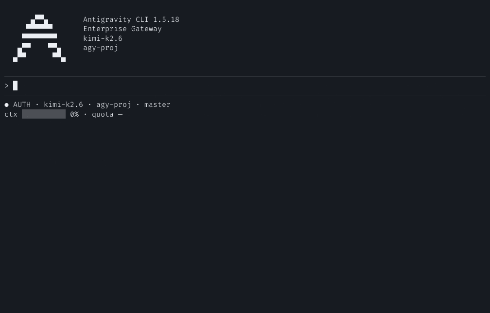
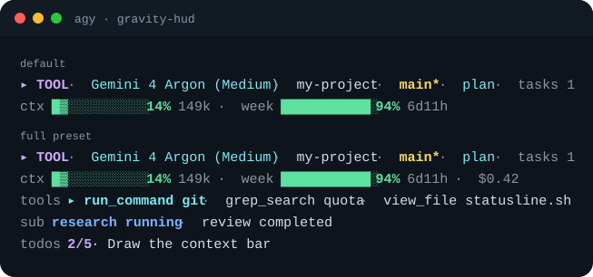

# gravity-hud

> [English](README.md) | 简体中文

[](LICENSE)
[](https://github.com/sb1733831438-maker/gravity-hud/actions/workflows/ci.yml)
[](package.json)

**非官方项目。** gravity-hud 是独立的开源软件，与 Google 没有附属、背书或赞助关系。Antigravity 是 Google LLC 的商标。

这是 [Antigravity CLI](https://antigravity.google/docs/cli/statusline/)（`agy`）的实时状态栏。默认两行：代理在做什么、当前模型、所在仓库，以及上下文窗口和配额重置还剩多少。需要看到正在运行的工具和任务清单时，再打开 `full` 预设。

## 安装

```bash
npx github:sb1733831438-maker/gravity-hud install
```

这条命令运行本仓库的 `gravity-hud` 可执行文件。npm 包在计划中，目前还没有发布。

也可以从克隆安装：

```bash
git clone https://github.com/sb1733831438-maker/gravity-hud.git
cd gravity-hud
node bin/gravity-hud.js install
```

需要 Node.js 18 或更新版本。安装后重启 `agy`；如果命令被保存成禁用状态，运行 `/statusline enable`。

## 你会看到什么



这是一段真实的 `agy` 1.5.18 会话录像，使用 `full` 预设，可以看到模型、上下文条、正在调用的工具、待办，以及一个子代理。下面的静图是同一套渲染器的输出，来自 [`fixtures/session.json`](fixtures/session.json) 和 [`fixtures/transcript.jsonl`](fixtures/transcript.jsonl)，生成文件为 `assets/hero.svg`。默认安装只显示前两行。`full` 预设额外显示工具、子代理、待办和费用。预览里的 git 状态是示例值 `main*`。



同一段输出去掉颜色后的纯文本：

```text
▸ TOOL · Gemini 4 Argon (Medium) · my-project · main* · plan · tasks 1
ctx █▓░░░░░░░░░░ 14% 149k · week ███████████░ 94% 6d11h · $0.42
tools ▸ run_command git · grep_search quota · view_file statusline.sh
sub 1 running · 1 done
todos 2/5 · Draw the context bar
```

灵感来自 Jarrod Watts 的 [claude-hud](https://github.com/jarrodwatts/claude-hud)（MIT，Copyright (c) 2026 Jarrod Watts）。gravity-hud 是为 `agy` 另写的程序，不是该项目的分叉或换皮。

- 代理状态、模型与 effort、项目目录，以及本地 git 分支。工作区有未提交改动时，分支名后带 `*`。
- 上下文条（已用）和配额条（剩余），重置倒计时来自 `reset_in_seconds` 或 `reset_time`。
- 窄终端会丢掉低优先级片段，而不是把一行拆乱。`TERM=dumb` 或 `--ascii` 时进度条改为 `#` 和 `-`。
- 可选行在默认预设中关闭：当前与最近的工具、子代理，以及从会话 transcript 解析出的待办进度。
- transcript 按增量解析。缓存记下文件偏移，刷新时不必重读整份日志。
- 除 Node.js 之外没有运行时依赖。
- JSON 缺字段或类型不明时，显示短横线或简短标签。进程仍然打印一行并以 0 退出，避免 `agy` 在连续失败后停用状态栏。

不启动 `agy` 也能看示例：

```bash
node bin/gravity-hud.js preview
node bin/gravity-hud.js preview --preset full --width 96
node bin/gravity-hud.js < fixtures/session.json
```

## 比较

下面是截至 2026 年 11 月的公开项目，用来说明各自侧重，不是排名。

| | gravity-hud | [agy-powerline](https://github.com/wassim-azi/agy-powerline) | [antigravity-cli-statusline](https://github.com/AndyAWD/antigravity-cli-statusline) | [agy-hud](https://github.com/franksde/agy-hud) | [antigravity-cli-statusline](https://github.com/weby-homelab/antigravity-cli-statusline) |
| --- | --- | --- | --- | --- | --- |
| transcript 工具与待办 | 有，增量解析 | 会话载荷上的小部件 | 大量指标 | 上下文、配额、模型、代理状态 | 载荷字段；不解析 transcript 清单 |
| 上下文与配额 | 进度条和重置倒计时 | 进度条、节奏和耗尽预测 | 多个配额池和多语言 | 紧凑进度条 | 进度条、token 计数、重置倒计时 |
| Git | 本地 git 的分支和脏标记 | 分支、领先/落后、stash、链接 | 分支和脏标记 | 有限 | 分支和脏标记，来自载荷或本地 git |
| 主题 | 4 个预设，16 色 | 多套主题和实时编辑器 | 语言和标签样式 | 图标集 | 256 色加 Nerd Font，另有 16 色经典模式 |
| 运行时依赖 | 除 Node.js 外无 | 无 | Node.js | Node.js（已打包脚本） | Bash 与 `jq`，或 Windows PowerShell |
| 安装 | `npx github:sb1733831438-maker/gravity-hud install` | `npx agy-powerline` | `agy plugin install` | 插件压缩包 | `install.sh` / `install.ps1` 修改 `settings.json` |
| 网络 | 从不访问 | 项目说明中称没有 | 状态栏本身不需要 | 可以通过 `agy` 刷新配额 | 不上传会话载荷 |

gravity-hud 不会预测配额何时用完。如果需要节奏预测，agy-powerline 是专门做这件事的。本项目从会话 transcript 读取工具和待办。[Weby Homelab 的状态栏](https://github.com/weby-homelab/antigravity-cli-statusline)是另一套 Bash 与 PowerShell 渲染器，带主机指标和按宽度打包的行。

<details>
<summary>安装细节、参数，以及 Antigravity 插件</summary>

`node bin/gravity-hud.js install` 会把一个很小的启动脚本复制到 `~/.gemini/antigravity-cli/gravity-hud/`。如果 `~/.gemini/antigravity-cli/settings.json` 已经存在，会先做备份，然后写入：

```json
{
  "statusLine": {
    "type": "command",
    "command": "~/.gemini/antigravity-cli/gravity-hud/statusline.sh"
  }
}
```

Windows 上对应的命令是 `statusline.cmd`。`agy` 会展开命令开头的 `~`。

```bash
node bin/gravity-hud.js install --dry-run
node bin/gravity-hud.js install --preset full
node bin/gravity-hud.js install --force    # 替换另一套状态栏命令
node bin/gravity-hud.js uninstall          # 恢复之前的 statusLine
```

如果现有的 `statusLine.command` 不是 gravity-hud，不带 `--force` 就不会改它。JSON 无法解析时，文件保持原样。写入通过一次重命名完成；在 Unix 上权限为 `0600`。`settings.json` 旁边最多保留五份带时间戳的备份。

插件安装会放上文件和 `/gravity-hud` 技能。[插件清单](https://antigravity.google/docs/build-plugins/)没有状态栏字段，所以它本身不会改 `settings.json`：

```bash
agy plugin install https://github.com/sb1733831438-maker/gravity-hud
node ~/.gemini/config/plugins/gravity-hud/bin/gravity-hud.js install
```

也可以在 TUI 里把 `/statusline` 指到启动脚本：

```text
/statusline ~/.gemini/antigravity-cli/gravity-hud/statusline.sh
```

`node bin/gravity-hud.js doctor` 只说明状态栏是否已配置。它不打印命令字符串，也不打印任何会话字段。

</details>

## 配置

安装程序只会在配置文件不存在时创建它，不会覆盖已有文件。

| 平台 | 路径 |
| --- | --- |
| macOS 与 Linux | `~/.config/gravity-hud/config.json` |
| Windows | `%APPDATA%\gravity-hud\config.json` |

`GRAVITY_HUD_CONFIG_DIR` 和 `GRAVITY_HUD_HOME` 可以改这些位置。单次运行时，`NO_COLOR` 或 `GRAVITY_HUD_ASCII=1` 优先于配置文件。

```json
{
  "preset": "compact",
  "theme": "gravity",
  "ascii": "auto",
  "color": "auto"
}
```

安装程序只写这四个键。只有在你想覆盖预设时才加 `segments`。如果 `segments` 是某个预设的完整副本，它会被忽略，因此把 `preset` 改成 `full` 仍然会切换布局，即使旧的安装程序曾经把每个开关都写进文件。

预设：

| 预设 | 内容 |
| --- | --- |
| `minimal` | 状态、模型、git、上下文、配额 |
| `compact` | 默认。再加上项目、模式、沙箱和后台任务数 |
| `full` | 在 compact 之上加上工具、子代理、transcript 待办和估算费用 |

主题有 `gravity`（默认）、`dawn`、`ember`、`mono`。它们只用 16 色 ANSI，以便在 `agy` 的 TUI 里保持可读。`colors` 可以替换单个 ANSI 色号，例如 `{ "model": "95", "good": "96" }`。`bars.width` 设置进度条长度（4–20）。`gitTimeoutMs` 限制本地 `git status` 的时间（50–2000，默认 180）。

单独的片段开关仍然优先于预设。只想在 `compact` 上多看一行工具时，把 `"tools"` 设为 `true`。

## 待办和工具从哪里来

`agy` 不会把清单放进 stdin。状态栏读取会话 JSON 里的 `transcript_path`。每一行是一个 step。工具调用在 `PLANNER_RESPONSE.tool_calls`（`name`、`args`）里，紧随其后的 step（`VIEW_FILE`、`RUN_COMMAND`、`CODE_ACTION`、`GENERIC` 等）是结果。

agy 1.5.18 的清单来自最近一次 `update_steps`。`steps` 是 JSON 字符串，元素为 `{status, title}`，status 为 `pending`、`in_progress` 或 `done`。更早的 transcript 仍然可用：

- 写入 `task.md` 的 `write_to_file`（或 `ArtifactMetadata.ArtifactType` 为 `task`）用 `CodeContent` 替换整份清单。
- `replace_file_content` 和 `multi_replace_file_content` 用 `ReplacementContent` 与 `ReplacementChunks` 更新对应条目。
- 还没有清单时，`task_boundary` 提供当前任务名和状态。

标记沿用任务文件的写法：`[ ]` 未开始，`[/]` 进行中，`[x]` 完成。普通源码文件里的勾选框会被忽略。工具标签只显示文件名或程序名，不显示完整命令行。

缓存是配置目录下的一份小 JSON，只保存文件偏移和这些短标签。首次读取超过 1.5 MB 的文件时只扫尾部 512 KB，免得一次刷新太慢；之后的追加内容从保存的偏移继续读。

## 隐私

- stdin 里的账户 `email` 会在渲染前删除；如果它仍然出现在输出里，也会被抹掉。没有开关可以把它显示出来。
- 进程不打开网络连接，也不调用 `fetch`。
- 不读取 `~/.ssh`、云凭证文件或系统钥匙串。指向这些位置的 transcript 路径会被忽略。
- 不会上传任何内容。配置、缓存和安装副本都留在用户主目录里。
- `doctor` 只说明状态栏是否已配置。它不打印命令字符串、设置文件内容或任何会话字段。

详见 [SECURITY.md](SECURITY.md)。

## 已知限制

- [状态栏文档](https://antigravity.google/docs/cli/statusline/)里的 `vcs` 只列出 `type`（`git`、`jj`、`hg`）。官方示例脚本还会读 `branch` 和 `dirty`，这两项不在字段表里。gravity-hud 用 `git status` 取得分支和脏标记；只有 git 没有及时返回时，才退回载荷里的 `branch` / `dirty`。`jj` 和 `hg` 显示类型，仅当载荷里带了分支名时才显示分支。
- 状态栏文档没有规定 transcript 的 step 格式。解析器依据已采集的 agy 1.5.18 会话（`update_steps`、`read_file`、`write_file`、`run_command`、`GENERIC` 结果）以及[钩子文档中的工具参数](https://antigravity.google/docs/hooks/)。未知参数名会被跳过。
- 官方载荷示例把 transcript 放在 `~/.gemini/antigravity/brain/<id>/.system_generated/logs/transcript.jsonl`。agy 1.5.18 的 `transcript_path` 仍指向 `~/.gemini/antigravity/brain/`，登录前会话 id 为空（`.../brain/.system_generated/logs/transcript.jsonl`），但 CLI 实际把文件写在 `~/.gemini/antigravity-cli/brain/<id>/`（`transcript.jsonl`，旁边还有 `transcript_full.jsonl`）。载荷路径上的文件存在时用它，否则改用同一 id 的 antigravity-cli 路径，再试两个 brain 目录。没有 id 且文件不存在的登录前路径会被跳过。
- 官方示例脚本处理了 `thinking`，所以这里也会渲染它。它不在文档列出的 `agent_state` 里（`idle`、`working`、`tool_use`、`reviewing`、`authenticating`、`initializing`、`error`）。
- 超过 1.5 MB 的 transcript 如果清单只写在文件头部，第一次读取可能看不到，直到后续编辑落在尾部。
- 配额桶的 id 不是封闭枚举。默认显示剩余比例最低的一桶；终端宽度至少 120 列时再显示第二桶。

## 开发

```bash
node scripts/lint.js
node --test
node scripts/render-hero.js
```

CI 在 Ubuntu、macOS 和 Windows 上对 Node.js 20 与 22 运行 lint 和 `node --test`。见 [CONTRIBUTING.md](CONTRIBUTING.md)。

## 许可证

[MIT](LICENSE)。Copyright (c) 2026 Binbin Sun。
